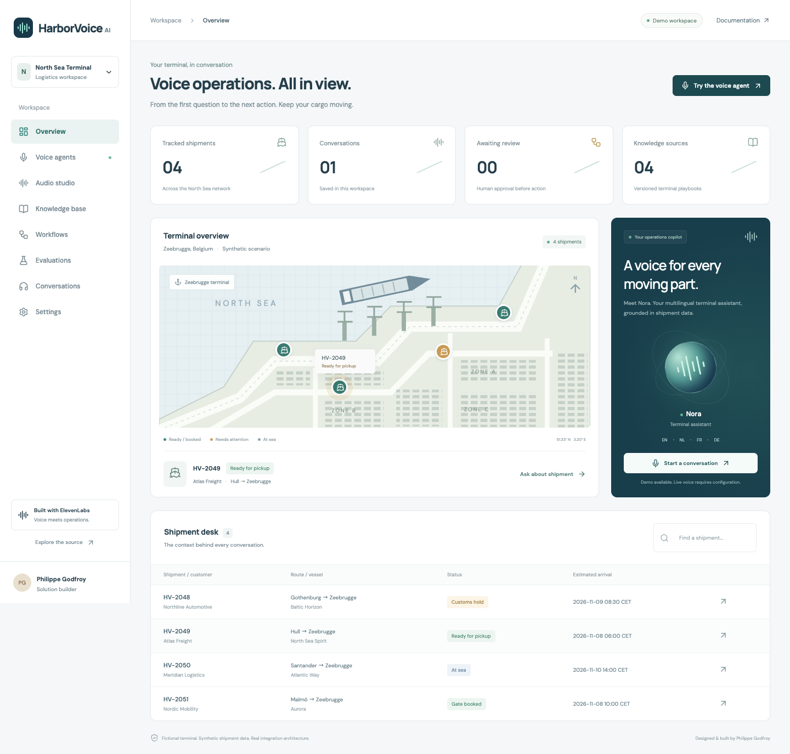

# HarborVoice AI

**A voice operations workbench for a fictional North Sea logistics terminal.**

Meet **Nora**: a multilingual terminal assistant that looks up shipments, explains terminal procedures and prepares escalations for operator review. Explore an interactive terminal map, eight ElevenLabs audio workflows, knowledge management, conversation history and reproducible evaluations.

[Explore the demo](https://phlppgdfry.github.io/harborvoice-ai/) · [Feature coverage](docs/feature-coverage.md) · [Architecture](docs/architecture.md) · [Verification evidence](docs/browser-verification.json)



> Independent portfolio project by Philippe Godfroy. The company, shipments and operating procedures are fictional. Demo conversations are deterministic scripts, not AI responses. Live ElevenLabs features are implemented and type-checked, but have **not been exercised against an authenticated ElevenLabs account** in the recorded verification run. No certification, LinkedIn badge, partnership or platform endorsement is claimed.

## Run locally

Requires Node.js **22.13+** (24 LTS recommended) and npm.

```bash
git clone https://github.com/phlppgdfry/harborvoice-ai.git
cd harborvoice-ai
npm ci
npm run dev
```

Open **http://127.0.0.1:5173**. No credentials are needed for the demo. The API listens on port 3100. SQLite data lives in `var/harborvoice.sqlite`, excluded from Git. The GitHub Pages demo has no server: it uses browser storage instead, with the same domain logic. Browser data stays in that browser; it is not synchronised to GitHub or ElevenLabs.

## A two-minute walkthrough

1. Select a shipment on the terminal map. Filter the shipment desk by customer, reference or vessel.
2. Open **Voice agents** and ask `Where is HV-2048?`. The scripted adapter returns the recorded customs hold, location and ETA, with a source reference.
3. Select **Nederlands** and ask `Waar is HV-2049?`.
4. Ask `Escalate HV-2048 to an operator`. Open **Workflows** and approve or reject the proposal. Approval records the operator decision; it does not release cargo, remove a customs hold or send a message to anyone.
5. Run **Evaluations** and download the results. Open **Conversations** to inspect and export the actual saved transcript.
6. Configure ElevenLabs to use live voice, knowledge uploads, agent simulations and the audio studio.

## What's inside

- **Voice agent** — authenticated signed-URL sessions, microphone conversations, live transcript, four selectable languages, volume control and application tools.
- **Shipment integration** — exact-reference lookup against a synthetic TMS adapter; unknown-reference abstention; source-grounded demo answers.
- **Knowledge** — four versioned operating playbooks; text document creation and attachment to the configured live agent.
- **Human-reviewed workflows** — idempotent pending escalations, approve/reject decisions and a persisted activity trail. No external business-system writes.
- **Audio studio** — text to speech, speech to text with diarization, sound effects, voice isolation, dubbing jobs, instrumental music, voice changing and forced alignment. Audio outputs can be played/downloaded; JSON outputs are inspectable. Dubbing exposes job submission and status; final rendered-dub download is not included.
- **Evaluation** — six executable demo checks; a live ElevenLabs simulation test with invocation polling and evidence export. Demo checks and live results are explicitly separate.
- **Conversation analytics** — actual saved session/message counts, separated demo/live sessions and downloadable transcripts. Browser-reported live transcripts are not independently verified provider records.
- **Webhook intake** — HMAC verification over the raw body, five-minute timestamp tolerance, deduplication and separate event storage. Webhook events do not drive shipment changes or automatically populate conversation analytics.
- **Delivery** — responsive React interface, typed Node API, SQLite, Docker, CI, static demo publishing, tests and screenshots.

This is a broad ElevenLabs integration showcase, **not every endpoint or enterprise feature in ElevenLabs**. See the [coverage matrix](docs/feature-coverage.md) for explicit boundaries.

## Live ElevenLabs setup

1. Create an ElevenLabs API key with the permissions needed for the features you intend to use. Enter it only into your local server environment; never into GitHub source or a `VITE_` variable.
2. Prepare the environment file:

   ```bash
   cp .env.example .env
   ```

   Set `ELEVENLABS_API_KEY` in `.env`. The file is ignored by Git.

3. Provision the agent:

   ```bash
   npm run agent:provision
   ```

   This creates four knowledge documents, two client tools and one authenticated Nora agent in your ElevenLabs account. The ignored `var/agent-manifest.json` records completed steps so a retry can resume without recreating completed resources. It is a bootstrap script, not a reconciler: changes to local playbooks do not update existing account resources automatically. Keep the manifest to avoid duplicate resources. Account permissions, supported models and plan availability can affect provisioning.

4. Set the printed `ELEVENLABS_AGENT_ID` in `.env`, restart the server and reload the application.
5. Open **Voice agents → Start live voice**. Grant microphone access. The language selector is passed as a permitted language override. Test each intended language before relying on it.

Audio requests, live calls and simulations may consume account credits. Creating resources also depends on your account permissions and limits. No live requests are made just by opening the unconfigured demo. Voice lists are read when a configured audio studio is opened. The live simulation creates a new test resource per run; remove unwanted test resources in ElevenLabs.

The agent's `lookup_shipment` and `request_escalation` tools execute through the connected HarborVoice browser. They are suitable for this browser demo, not standalone telephone calls. A telephony deployment needs authenticated server tools, caller authorisation and separate production infrastructure.

### Operator access

The default server binds to loopback. To bind to a network interface, set `HOST=0.0.0.0` and a strong `OPERATOR_TOKEN`. The server refuses non-loopback binding without a token. Enter that token in **Settings**; it is held in session storage for the current browser tab. Reload to reconnect.

This shared operator token is for a single-user workbench, not enterprise SSO or role separation. Do not deploy it as a public customer service without an authentication layer, TLS, per-user permissions, caller verification, retention controls and spend limits. Operator access includes all workspace data and paid features.

### Webhooks

Expose `POST /api/webhooks/elevenlabs` over HTTPS using your deployment infrastructure, set `ELEVENLABS_WEBHOOK_SECRET`, and configure the matching ElevenLabs webhook. Signature verification is covered by local tests. Real ElevenLabs webhook delivery has not been verified. Raw payloads are retained in a separate SQLite table; apply a retention policy before using personal data.

## Verification

```bash
npm run check                 # TypeScript + production build + 17 tests
npm run dev                   # In another terminal
npm run test:browser          # Installed Google Chrome, or BROWSER_CHANNEL=chromium
```

The API tests use temporary in-memory SQLite and an ephemeral local HTTP server. They never call ElevenLabs and never spend credits. The browser script performs a real demo conversation, Dutch reply, escalation approval, evidence export, history inspection, all-page navigation and a 390px mobile overflow check. It writes screenshots and a verification report to `docs/` and changes the local demo workspace while testing.

For CI, install the browser first with `npx playwright install --with-deps chromium`, then use `BROWSER_CHANNEL=chromium npm run test:browser` while the dev server is running.

The production build lazily loads the voice console and its SDK. The ElevenLabs voice bundle is sizeable; Vite currently reports a >500 kB chunk warning. The overview does not load that bundle until the voice console opens.

## Deploy

Static review demo: the included GitHub Actions workflow builds and publishes `dist` to GitHub Pages. No secrets or backend are bundled. Enable Pages with **GitHub Actions** as the source. A static demo cannot make live ElevenLabs calls.

Full local deployment:

```bash
npm run build
npm start
# http://127.0.0.1:3100
```

Docker (set a strong token in `.env` first):

```bash
docker compose up --build
# http://localhost:3100
```

The Docker volume persists SQLite. The container runs as an unprivileged user and publishes only on host loopback by default. Review [architecture and limitations](docs/architecture.md) before a network deployment.

## Project structure

```text
src/         Dashboard, voice console, static-demo adapter and shared domain logic
server/      API, SQLite store, ElevenLabs adapter and webhook verification
scripts/     Resumable agent bootstrap and browser walkthrough
tests/      Domain and API integration tests
docs/       Feature matrix, architecture, screenshots and verification evidence
```

## References

Built against the installed official [`@elevenlabs/react`](https://github.com/elevenlabs/packages) and [`@elevenlabs/elevenlabs-js`](https://github.com/elevenlabs/elevenlabs-js) packages. Versions are locked in `package-lock.json`. [ElevenAgents documentation](https://elevenlabs.io/docs/eleven-agents/overview) · [ElevenLabs API documentation](https://elevenlabs.io/docs/overview).

MIT licensed. This repository supplies project evidence, not proof of usage, certification or professional accreditation. LinkedIn Connected Apps, if available to your account, must be connected and validated in the relevant platforms.
