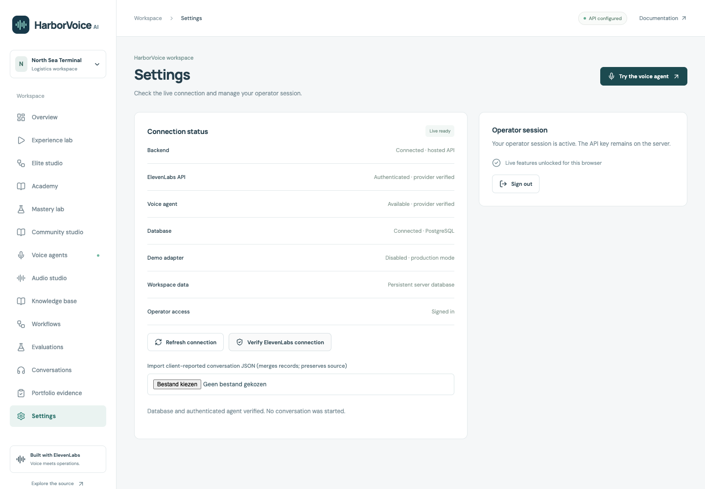
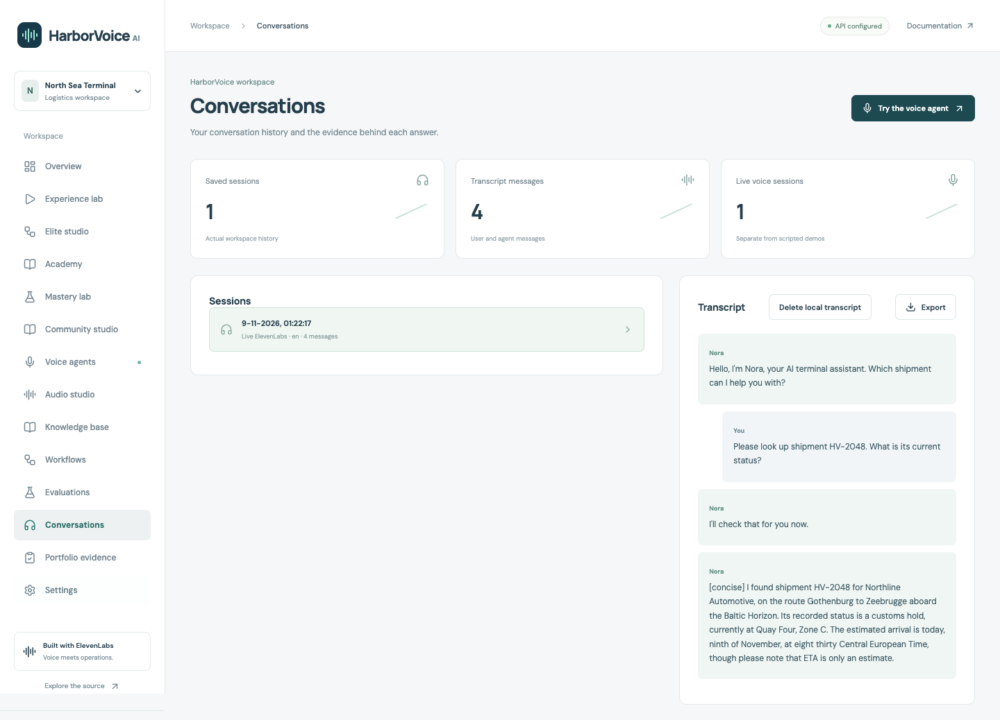

# Project finalization report — HarborVoice persistent runtime

Verified 9 November 2026. This report concerns the private single-operator application,
with synthetic logistics records. It does not certify a customer deployment or enterprise SaaS.

## 1. Overall status

| Acceptance question                     | Result                                                                             |
| --------------------------------------- | ---------------------------------------------------------------------------------- |
| Production ready, without qualification | **NO** — operational/manual acceptance below remains                               |
| Production deployed                     | **YES** — https://harborvoice-ai.vercel.app                                        |
| Real ElevenLabs connected               | **YES** — authenticated provider reads and actual WebSocket voice                  |
| Voice agent operational                 | **YES** — one authorized synthetic-microphone production call                      |
| GitHub synchronized                     | **YES** — feature branch published, draft PR #1; main not changed by this delivery |

The original static/browser-storage gateway is no longer the production workspace backend.
This is an operational deployed application; it is not an unrestricted production-readiness claim.

## 2. Actual architecture

React/Vite → same-origin Express Vercel Function → dedicated Neon PostgreSQL workspace.
The server holds the ElevenLabs key and issues a signed URL only to an authenticated operator
for the configured private agent. The official React SDK streams audio directly to ElevenLabs.
A separate Neon Free resource isolates preview data from production. Local durable-file
installations can retain SQLite; explicitly selected Pages/demo builds retain synthetic behavior.
Production refuses browser/deterministic fallback. Human review remains outside the model.

See [architecture](architecture.md), [deployment](deployment.md),
[security](security.md) and [integration](elevenlabs-integration.md).

## 3. Completed changes

- `server/postgres.ts`, `server/migrations/001_workspace.sql`, `scripts/migrate.ts`:
  versioned private schema, validated JSON, verified TLS, bounded pooling, row-locked
  transactions, rollback, idempotent initialization and refusal of silent reseeding after loss.
- `server/{runtime,gateway,index,app}.ts`: strict production config, real health/readiness,
  configured-agent selection, protected conversation retrieval/import/deletion, retention
  maintenance, validated requests and safe error/metadata logging.
- `server/{operator-auth,store}.ts`: random signed-session nonces, persistent logout
  revocation, SQLite compatibility and retention cleanup. No client-assigned roles.
- `src/{api,main,ConnectionSettings,VoiceAgent}.tsx` (API module is `.ts`): fail-closed
  production UI, truthful status, opt-in remembered login, import/delete, cancellation,
  SDK-driven lifecycle/muting, save-error handling and persisted session metadata.
- SDK worklets/resampler are pinned and bundled as separate same-origin assets. The
  verified CSP failure was fixed without allowing blob/data scripts or a remote worklet CDN.
  Vendor license notices ship under `public/vendor`.
- Added real PostgreSQL, browser SDK-fixture and deployed-runtime verification; pinned
  relevant Actions, added dependency/asset checks and a production-CSP browser regression.
- Preserved and integrated concurrent Elite/Community Studio changes through merge commits.
  No feature branches, historical evidence or unrelated worktrees were removed.

## 4. Tests actually executed

| Check                                                                       | Result and boundary                                                                                                                          |
| --------------------------------------------------------------------------- | -------------------------------------------------------------------------------------------------------------------------------------------- |
| `npm run check`                                                             | PASS: TypeScript + Vite build; 63 tests, 62 passed, 0 failed, 1 explicit PostgreSQL skip                                                     |
| `npm run test:postgres`                                                     | PASS separately: 2 passed, 0 skipped; real Docker PostgreSQL migration/concurrency/rollback/restart/auth checks, then actual dump/restore    |
| `npm run format:check`, `npm run typecheck`                                 | PASS; lint script is Prettier, not an ESLint/security audit                                                                                  |
| `npm audit --audit-level=high`                                              | PASS; zero reported vulnerabilities at execution                                                                                             |
| Demo/Academy/Elite/Community browser suites                                 | PASS in hosted CI; existing functionality retained, paid API transport fixtures clearly identified                                           |
| `npm run test:production-browser`                                           | PASS with SDK/WebSocket/API fixtures, synthetic microphone, muting, persistence contract, failure UI and mobile checks                       |
| Same SDK fixture on built Express + production CSP                          | PASS after fixing a real worklet-loading failure; also executed in hosted CI                                                                 |
| `npm run elite:validate`, `npm run recognition:validate`                    | PASS; publication contract and asset integrity; not proof of new live deployment of native resources                                         |
| Gitleaks staged diff and Git history                                        | PASS at scan time; no leaks found; no secret scan guarantees complete absence                                                                |
| Public HTTPS/API + operator readiness/logout                                | PASS against the actual production deployment                                                                                                |
| One real voice smoke                                                        | PASS: actual ASR, shipment lookup, response audio, persisted callback transcript and refresh                                                 |
| Inherited Phase 3 offline checks                                            | PASS: 33 AgentOps tests, 13 workshop/contribution tests, 110 deterministic fixture scenarios and AgentProof build; not live model evaluation |
| Human microphone/device quality; all paid audio products on this deployment | NOT EXECUTED as a full acceptance suite                                                                                                      |

Hosted implementation gates: [push run](https://github.com/phlppgdfry/harborvoice-ai/actions/runs/42535880806),
[PR run](https://github.com/phlppgdfry/harborvoice-ai/actions/runs/42535885472).
Both completed successfully at implementation commit `234281a806150a79b12220d182df3fc9e97534b9`.
Final documentation commits have separate CI results in the PR; they are not silently equated
with the deployed implementation. See [test instructions](testing.md).

Earlier failures are not hidden: repeated-decision HTTP compatibility was restored;
the first CLI preview failed missing production credentials; a manual production build was
rejected for absent Git metadata; strict CSP blocked default SDK worklets. The deployed
candidate subsequently passed through the existing GitHub CI publication gate.

## 5. Real-provider evidence

[Machine-readable production evidence](production-verification.json) records the one owner-
authorized call. The provider independently reported `done`, **14 seconds**, six transcript
entries: four text events plus tool-call/result records. The browser stored four callback
messages and received **30 audio frames**. No second call was made.

The prerecorded question was: “Please look up shipment HV-2048. What is its current status?”
The answer identified the recorded customs hold. The transcript is client-reported and can
include queued response text not fully spoken before termination; it is not provider attestation.
The immediate account credit delta was zero, with possible delayed billing: no zero-cost
claim follows. No paid upgrade or service purchase was made.

One successful question is not a general model quality evaluation. Historical evaluation
failures, scoped remediations and lack of a complete rerun remain in the existing evidence.

Both screenshots were captured from functioning production screens and visually inspected.
No Microsoft, provider dashboard or successful response was fabricated.

## 6. Security and operational limits

Implemented: server-side operator checks, signed HttpOnly/Secure/Strict cookies, durable
logout revocation, exact-origin checks, bounded inputs/uploads, private database schema,
parameterized queries, verified TLS, transactional updates, CSP/security headers, no-store
private API responses and metadata-only request logs. AI cannot approve or release cargo.

This is one shared operator workspace, not independently authenticated employee accounts,
SSO, tenant isolation or separation of duties between different human identities. In-memory
rate limits are per instance, not a distributed spend cap. No penetration test or blanket
GDPR compliance is claimed. Local deletion does not delete provider recordings. Credentials
and private audio remain outside Git; only synthetic, reviewed evidence is published.

## 7. Deployment and GitHub

- [Repository](https://github.com/phlppgdfry/harborvoice-ai)
- [Feature branch](https://github.com/phlppgdfry/harborvoice-ai/tree/production/persistent-runtime)
- [Draft PR #1](https://github.com/phlppgdfry/harborvoice-ai/pull/1) — unmerged, feature branch retained.
- Deployed implementation: `234281a806150a79b12220d182df3fc9e97534b9`.
- [Production deployment](https://harborvoice-qzt51h8is-kippiegs-projects.vercel.app),
  aliased to https://harborvoice-ai.vercel.app.
- Existing production operator/provider credentials were preserved. Preview uses a separate
  operator secret. Free databases were explicitly selected in Frankfurt, with no upgrades.
- Main advanced independently during this task; changes through `b129328` were preserved
  in the candidate. This task did not push directly to main or merge the draft PR.

## 8. Remaining acceptance items

**Blocker:** full real-device voice acceptance.
**Reason:** automation used Chromium and a prerecorded synthetic microphone.
**Impact:** physical microphone restrictions, browser/device compatibility and subjective
speech quality are not fully accepted.
**Exact action required:** owner signs in and checks microphone permission, mute, response
playback, stop and saved history on their intended device. Further calls consume existing credits.

**Blocker:** operational handling of real personal data.
**Reason:** no live backup/restore drill, scheduled retention deadline, provider DPA/recording
retention decision or named support owner has been accepted.
**Impact:** broad customer-data production readiness remains unverified.
**Exact action required:** keep synthetic data until those procedures/settings are reviewed;
configure encrypted backups and idle retention maintenance, then verify a separate restore.
The disposable database restore test is already automated.

**Blocker:** account-dependent audio product acceptance.
**Reason:** eight product adapters have deterministic transport coverage, while historical
provider evidence documents permission/plan restrictions for some native/dubbing operations.
No account permissions or paid plan were expanded by this delivery.
**Impact:** a configured voice agent does not prove every ElevenLabs product is available.
**Exact action required:** review the existing capability/permission evidence and configure
only approved product scopes in the provider secret manager, or restrict unavailable products.
Do not purchase or expand permissions without owner authorization.

**Owner decision:** review/authorize merging PR #1. No merge is implied by deployment.
Until main contains the persistent runtime, a future main-branch production deployment
could replace it with the older browser-storage backend. This source/deployment alignment
is a release-management acceptance item; no automatic merge is authorized.
No additional voice calls, purchases, cloud deployments or broad feature work are required to
inspect this delivery. The existing browser data remains intact; see the import procedure.

## 9. Final verdict

**NOT PRODUCTION READY — ACTION REQUIRED**

The persistent application is deployed and its core real voice flow is verified. The broader
unqualified production acceptance request remains incomplete for the explicit manual,
operational and account-dependent reasons above. No simulated integration was substituted
for the real call, and no unexecuted check is labelled passed.
