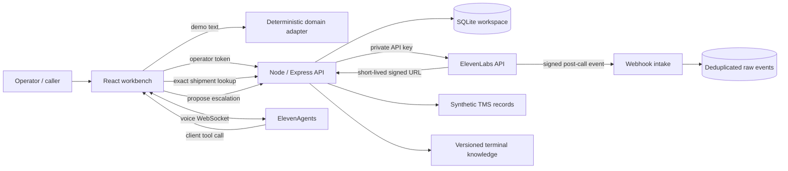

# Architecture and operating boundaries

## Two execution modes

**Static review demo:** Vite output is hosted on GitHub Pages. If the status endpoint is unavailable, the application explicitly selects demo mode. Its state is kept in browser storage, and shared domain functions answer scripted text questions. No audio, AI model or external operation is simulated as a successful live result.

**Local full stack:** Express serves the API and optionally the production UI. All credentials remain server-side. Workspace mutations run inside a synchronous SQLite transaction (`BEGIN IMMEDIATE`); an exception rolls back. SQLite WAL provides local persistence. Sessions and activity records are bounded at the API level; raw webhook payloads need an operator retention policy.

## Agent responsibilities

Nora may read a shipment by exact reference and prepare an escalation. She cannot execute a customs release, change an ETA, book a gate, send an email or modify external business systems. The sample knowledge base makes these limits explicit. System prompts are guidance, not the enforcement boundary: the API simply has no cargo-release operation.

The application registers two client tools. A tool call passes through the same authenticated API as the user interface. A missing browser or tool failure must lead to a transparent failure response. For telephone deployment, replace client tools with authenticated server tools and bind caller identity to authorised shipment access.

**Review limitation:** the operator token grants access to both proposals and decisions. The agent only receives proposal tools, but this is not independent-person separation of duties. A production design should use different identities and roles for caller, agent runtime and reviewer.

## Live versus reported evidence

- A saved demo transcript records deterministic adapter messages.
- A saved live transcript is reported by the browser callback; it is not authoritative provider evidence.
- A live test invocation returns the provider's raw test response; refresh until it finishes and inspect the actual evaluation results. A queued invocation is not a pass.
- Webhooks are verified and stored separately. They are not yet reconciled into the session dashboard.
- No fabricated latency, customer satisfaction, cost savings or success rates appear in the dashboard.

## Audio pipeline

The server validates text, enums, file count, MIME category and a 20 MB upload limit. Uploads stay in memory and are passed as File objects to the official SDK. MIME checks are not full media-content inspection. Generated audio is streamed to the browser; browser object URLs are revoked after replacement/unmount. Dubbing creates an asynchronous job and exposes its status; final dub rendering/download is outside this version.

Eight operations are exposed: TTS, STT, effects, isolation, dubbing, music, voice changing and forced alignment. A feature can still fail due to account permissions, credits, plan restrictions, voice access or model availability. None of these live operations has been validated against an authenticated account in this delivery.

## API surface

| Endpoint | Purpose |
| --- | --- |
| `GET /api/status` | Non-secret configuration availability |
| `GET /api/state` | Workspace snapshot |
| `POST /api/demo/chat` | Deterministic demo response + persistence |
| `POST /api/tools/lookup` | Exact synthetic shipment lookup |
| `POST /api/escalations` | Deduplicated pending proposal |
| `POST /api/escalations/review` | Operator approval/rejection |
| `POST /api/sessions` | Client-reported live transcript |
| `POST /api/agent/session` | Signed voice-session URL |
| `GET /api/voices` | Available ElevenLabs voices |
| `POST /api/knowledge` | Create text document and attach to live agent |
| `POST /api/agent/simulate` | Create and run a simulation test |
| `GET /api/agent/test-runs/:id` | Refresh provider invocation results |
| `POST /api/audio/:tool` | One of the eight bounded audio operations |
| `GET /api/dubbing/:id` | Dubbing job status |
| `POST /api/webhooks/elevenlabs` | Signed, deduplicated event intake |

All API routes except status and signed webhook intake require the configured operator token. Origin checks reject mismatched origins; unauthenticated loopback access also rejects unexpected Host headers. Ordinary routes permit 90 requests/minute per IP; credit-consuming endpoints additionally permit 8/minute. These are local process limits, not distributed spend controls. The server does not trust proxy headers by default.

## Production work remaining

Enterprise identity and tenant isolation; caller authorisation; service-side tools; network/TLS design; independent reviewer permissions; provider transcript reconciliation; per-identity credit budgets; media inspection; retention/deletion jobs; reliable queues for long audio jobs; backups; observability; real multilingual agent evaluations; deployment smoke tests; accessibility audit and load testing. None is implied by the term "workbench" or the presence of a Dockerfile.
