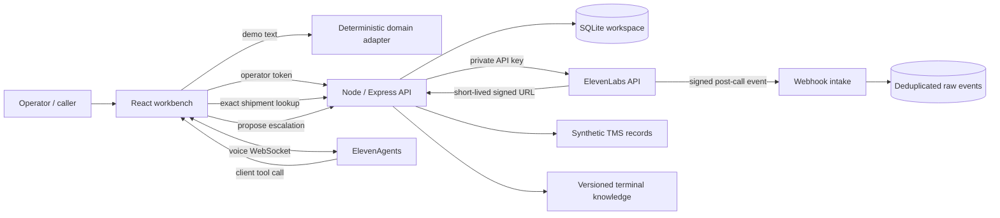

# Architecture and operating boundaries

This diagram describes Main's local/demo architecture. The existing live Vercel deployment is a separate protected PostgreSQL implementation, verified on 10 November 2026; see the [current architecture and acceptance audit](final-excellence/technical-audit.md). Main must not overwrite that persistent runtime. Production PR #1 remains draft and operational acceptance is incomplete.

## Execution modes

**Static review demo:** Vite output is hosted on GitHub Pages. The Pages build explicitly selects preview mode; an unavailable backend in a live build is reported as unreachable. Its state is kept in browser storage, and shared domain functions answer scripted text questions. No audio, AI model or external operation is simulated as a successful live result.

**Local full stack:** Express serves the API and optionally the production UI. All credentials remain server-side. Workspace mutations run inside a synchronous SQLite transaction (`BEGIN IMMEDIATE`); an exception rolls back. SQLite WAL provides local persistence. Sessions and activity records are bounded at the API level; raw webhook payloads need an operator retention policy.

**Hosted live gateway:** Vercel serves the frontend and a same-origin Express API. Credentials remain in encrypted production environment variables. Browser storage owns workspace persistence; no ephemeral serverless database is presented as durable. SQLite-only routes and webhook intake are disabled. Operator access uses a signed HttpOnly, Secure, SameSite=Strict cookie (eight hours, optionally 30 days); login checks origin and a constant-time access-code comparison. Rotating OPERATOR_TOKEN revokes existing cookies. Provider calls remain protected behind operator authentication.

## Agent responsibilities

Nora may read a shipment by exact reference and prepare an escalation. She cannot execute a customs release, change an ETA, book a gate, send an email or modify external business systems. The sample knowledge base makes these limits explicit. System prompts are guidance, not the enforcement boundary: the API simply has no cargo-release operation.

The application registers two client tools. A tool call passes through the same authenticated API as the user interface. A missing browser or tool failure must lead to a transparent failure response. For telephone deployment, replace client tools with authenticated server tools and bind caller identity to authorised shipment access.

**Review limitation:** the operator token grants access to both proposals and decisions. The agent only receives proposal tools, but this is not independent-person separation of duties. A production design should use different identities and roles for caller, agent runtime and reviewer.

## Live versus reported evidence

- A saved demo transcript records deterministic adapter messages.
- A saved live transcript is reported by the browser callback; it is not authoritative provider evidence.
- A live test invocation returns the provider's raw test response; refresh until it finishes and inspect the actual evaluation results. A queued invocation is not a pass.
- Webhooks are verified and stored separately. They are not yet reconciled into the session dashboard.
- No fabricated latency, customer satisfaction, cost savings or success rates appear in the dashboard.

## Audio pipeline

The server validates text, enums, file count, MIME category and a 20 MiB local / 4 MiB hosted upload limit. Uploads stay in memory and are passed as File objects to the official SDK. MIME checks are not full media-content inspection. Generated audio is streamed to the browser; browser object URLs are revoked after replacement/unmount. Dubbing creates an asynchronous job, exposes its status, and streams the original automatic audio dub only after the provider reports `dubbed`. Edited Studio renders remain outside this version.

Eight operations are exposed: TTS, STT, effects, isolation, dubbing, music, voice changing and forced alignment. A feature can still fail due to account permissions, credits, plan restrictions, voice access or model availability. Basic TTS connectivity was subsequently verified with an explicitly approved official onboarding request (HTTP 200, valid MP3). The other audio operations remain covered by SDK transport fixtures and still need live account runs.

## API surface

| Endpoint                        | Purpose                                       |
| ------------------------------- | --------------------------------------------- |
| `GET /api/status`               | Non-secret configuration availability         |
| `GET /api/state`                | Workspace snapshot                            |
| `POST /api/demo/chat`           | Deterministic demo response + persistence     |
| `POST /api/tools/lookup`        | Exact synthetic shipment lookup               |
| `POST /api/escalations`         | Deduplicated pending proposal                 |
| `POST /api/escalations/review`  | Operator approval/rejection                   |
| `POST /api/sessions`            | Client-reported live transcript               |
| `POST /api/agent/session`       | Signed voice-session URL                      |
| `GET /api/voices`               | Available ElevenLabs voices                   |
| `POST /api/knowledge`           | Create text document and attach to live agent |
| `POST /api/agent/simulate`      | Create and run a simulation test              |
| `GET /api/agent/test-runs/:id`  | Refresh provider invocation results           |
| `POST /api/audio/:tool`         | One of the eight bounded audio operations     |
| `GET /api/dubbing/:id`          | Dubbing job status                            |
| `POST /api/webhooks/elevenlabs` | Signed, deduplicated event intake             |

All API routes except status and signed webhook intake require the configured operator token. Origin checks reject mismatched origins; unauthenticated loopback access also rejects unexpected Host headers. Ordinary routes permit 90 requests/minute per IP; credit-consuming endpoints additionally permit 8/minute. These are local process limits, not distributed spend controls. The local server does not trust proxy headers; the hosted gateway trusts one platform proxy hop. Per-instance rate limits do not replace provider spending caps.

## Version 1.1 verification and lifecycle

`tests/elevenlabs-contract.test.ts` injects a real ElevenLabs SDK instance with a custom fetch transport. The transport returns synthetic provider responses and records paths, JSON, multipart fields and query parameters. No real account or billable generation is involved. Coverage includes all eight audio operations, signed sessions, dubbing download gating, read-only connection checks, concurrent knowledge uploads and the current create/run/poll test lifecycle.

The browser walkthrough additionally mocks API responses for all eight studio forms. This proves form submission/result rendering and download availability, not the quality or playability of provider-generated audio. A subsequent real visitor WebSocket test exercised ASR, the shipment lookup and incoming speech audio using a synthetic microphone recording. Human microphone capture and subjective quality remain unassessed. Real audio-product results and the API-key dubbing permission limitation are recorded in docs/audio-live-evidence.json. Live account reads, agent provisioning, signed-session issuance and one approved TTS generation have since been verified.

Knowledge read/append/update operations are queued by agent ID inside one server process. This avoids lost attachments from simultaneous app uploads; it is not a distributed lock for independent processes or external agent editors.

The voice UI follows `onConnect`/`onDisconnect` instead of treating the SDK's void-returning `startSession` wrapper as an awaited successful connection. Microphone mute uses the SDK's `setMuted`; speaker volume is controlled separately. Nonempty live transcripts are submitted when the voice view unmounts. Browser navigation and application shutdown can still interrupt network delivery; authoritative history should come from provider reconciliation.

| Additional endpoint                    | Purpose                                                      |
| -------------------------------------- | ------------------------------------------------------------ |
| `POST /api/connection/check`           | Explicit read-only voice-library access check                |
| `GET /api/dubbing/:id/audio/:language` | Gate on completed status, then stream original automatic dub |

## Real agent validation

Six bounded ElevenLabs LLM simulation tests passed in English, Dutch, French and German. They cover recorded shipment data, unknown references, customs refusal, pending human review, tool failure and knowledge-grounded gate procedures. Business tools use explicit synthetic fixtures. See `docs/agent-evaluation.json`; this is separate from microphone and telephony verification.

## Production work remaining

Enterprise identity and tenant isolation; caller authorisation; service-side tools; network/TLS design; independent reviewer permissions; provider transcript reconciliation; per-identity credit budgets; media inspection; retention/deletion jobs; reliable queues for long audio jobs; backups; observability; broader multilingual voice evaluations; accessibility audit and load testing. None is implied by the term "workbench" or the presence of a Dockerfile.

## Credential loading

The server entry point and provisioning/read-only verification scripts import `server/environment.ts`, which loads ignored `.env.local` first and `.env` second, without overriding inherited process credentials. Official onboarding owns `.env.local`; the real agent ID is stored in ignored `.env`. No API key is placed in client bundles or MCP configuration files. The static GitHub Pages demo has no access to these local files.

For the v2 resource ownership, budget governor, live scope and deployment gate, see [Elite architecture](elite/architecture.md) and [release report](elite/release-report.md). Historical incomplete-coverage statements above are superseded by the dated evidence in `docs/elite`.
