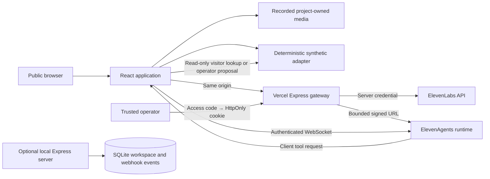
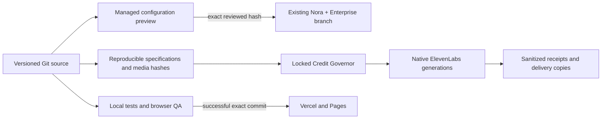

# Architecture and trust boundaries

HarborVoice is an independent fictional logistics workbench. Its architecture separates application source, synthetic business state, authenticated ElevenLabs runtime resources and recorded creative assets. “Enterprise” describes the demonstrated design problem, not a claim of enterprise certification or production terminal connectivity.

## Runtime topology

The public recording path does not generate audio. The text path is deterministic and does not invoke an LLM. The live agent path processes audio through ElevenLabs. Every production view should preserve this distinction.

## State ownership

| State                                                    | Source of truth                                     | Persistence and boundary                                              |
| -------------------------------------------------------- | --------------------------------------------------- | --------------------------------------------------------------------- |
| Application/domain logic                                 | Git repository                                      | Versioned source and tests                                            |
| Prompt, tool definitions, knowledge sources, evaluations | Git repository                                      | Explicit reconciliation is required before native changes             |
| Deployed agent/native project                            | ElevenLabs                                          | Native runtime state; remote manual edits must be detected            |
| Generated media                                          | Native platform plus published project-owned copies | Provenance, technical metadata and content hashes                     |
| Hosted synthetic shipment/ticket/session workspace       | Current browser                                     | Not shared between users; clearing storage deletes it                 |
| Local workspace/webhook intake                           | SQLite                                              | Local deployment only; backup/retention are operator responsibilities |
| Authentication secret and raw operation receipts         | Private environment/ignored `var/`                  | Never committed or embedded in a client bundle                        |
| Practice progress                                        | Browser-local Academy state                         | Self-guided progress, not verified credentials                        |

## Business action boundary

`lookup_shipment` resolves exact synthetic references. `request_escalation` creates a **Pending review** proposal. Approve/reject records an operator decision. None changes shipment status, clears customs, guarantees an ETA, sends an external message or transfers a telephone call.

The current tool transport is client-side. A disconnected browser cannot serve these tools, and a caller can inspect or modify their own browser state. This is suitable for a fictional portfolio demonstration, not an authorization mechanism for real cargo or private customer information. A production deployment needs authenticated service tools and independently verified callers/reviewers.

## Agent layer

Nora supports EN/NL/FR/DE, four operating playbooks and RAG, bounded conversations, language detection, authenticated sessions and explicit refusal/abstention rules. The visitor agent is separate, read-only and provider-limited. Provider simulations use controlled synthetic tool responses; they measure the assistant's behavior under those fixtures, not real TMS connectivity or speech quality.

## Resource delivery

A synchronization registry should link stable local sources to separate remote resource IDs. Managed configuration fields can be reconciled with reviewed hashes and snapshots. Studio and Flow edits require manual/native reconciliation when an official export/apply interface does not support the object. A media copy or README link is not synchronization of an editable project.

Budget reservations must precede paid requests. A governor can account for managed operations and observe account-wide counters; it cannot prevent simultaneous spending by an unrelated human UI session or another application. Keep a conservative reserve, detect unexpected consumption and stop new work when reliability is uncertain.

## Deployment modes

- **Vercel:** static frontend plus same-origin serverless API; browser-owned workspace; no durable webhook receiver or SQLite store.
- **GitHub Pages:** frontend, recorded assets and deterministic demo only; no provider credentials or backend.
- **Local/Docker:** Express, SQLite and signed webhook intake; loopback by default, explicit token required for network binding.

A main-branch code push, successful build, working public endpoint and native account verification are different delivery checks. Production publication must be gated on the appropriate tests and then verified after deployment.

## Evidence hierarchy

1. Code tests with SDK fixtures establish serialization, validation and business-rule behavior.
2. Native read checks establish current existence/settings/permissions.
3. Provider simulation results establish bounded LLM test outcomes.
4. A real voice interaction establishes the tested ASR/tool/audio path.
5. Technical media inspection establishes integrity, duration and dimensions.
6. Listening, language review and content inspection establish a narrower quality assessment; metadata decoding alone cannot establish naturalness or perfect translation.

See [baseline audit](current-state-audit.md), [security](security.md) and [limitations](limitations.md). The release evidence should identify the commit and timestamp for every fresh verification.

## Implemented v2 extensions

The native runtime retains editable creative projects and generated resources. The repository retains specifications, comparisons, source/metadata, download-safe outputs and test scope. Project-owned movie editing is local; native Studio captions and revisions have their own evidence. The resource reconciler refuses unreviewed remote drift and preserves unmanaged fields. The advanced learning UI and production gallery lazy-load independently.
