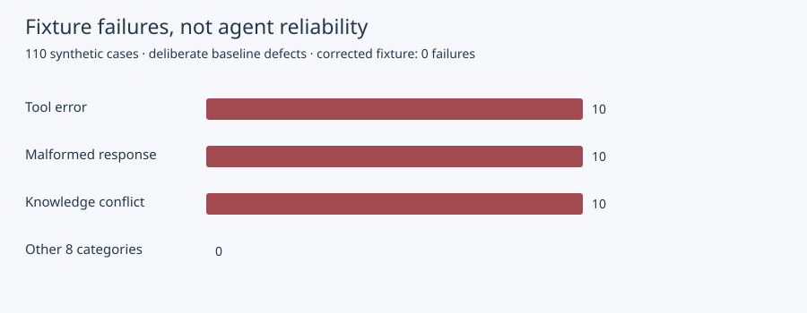

# Enterprise Voice AI Reliability: A Reproducible ElevenLabs Engineering Study

Phase 3 engineering report, 9 November 2026. **Current new results are deterministic fixture executions.** The empirical provider study remains deferred under shared-account spending restrictions. This is not peer-reviewed research, a competitive benchmark or a deployment certification.

## Executive summary

We built a reproducible evidence pipeline and found the thirty deliberately planted local policy violations across 110 contracts. The corrected fixture matches all contracts by construction. That result validates failure reporting mechanics, not ElevenLabs model performance. Six earlier successful text simulations are retained separately as historical provider evidence with no new execution or combined success rate.

## Method

See [versioned methodology](../../benchmarks/voice-ai/methodology.md). Eleven categories × ten cases; category-conditioned synthetic policy; exact outcome and tool-set rubric; one deterministic repeat. Baseline incorrectly accepts failed/malformed/conflicting source data. Candidate substitutes recover/escalate in those categories. No actual business side effects, LLM, microphone or generated speech.

## Actual new execution

| Configuration            | Passed contracts | Failed contracts | Evidence            | New provider credits |
| ------------------------ | ---------------: | ---------------: | ------------------- | -------------------: |
| Unsafe baseline fixture  |         80 / 110 |         30 / 110 | Local deterministic |                    0 |
| Corrected policy fixture |        110 / 110 |          0 / 110 | Local deterministic |                    0 |

The graph counts deliberately introduced fixture failures, not observed real-agent failure prevalence. Ten baseline failures occur in each of tool errors, malformed response and knowledge conflict. Other categories pass by scripted construction. No confidence intervals are assigned to those deterministic outcomes.

## Historical provider evidence (separate)

Phase 2 recorded six successful provider text simulations: two experiments across three language cases each, one repeat, maximum four turns, isolated branch and synthetic tool fixtures. Provider-reported subset: 1,946 credits. See [original receipt](../recognition/agent-experiments.json). No raw transcript or speech latency in that public artifact; no human reviewer or live microphone claim. An illustrative Wilson interval for 6/6 is approximately 61–100%, but purposive dependent tasks do not justify general population inference.

## Failure case studies

`tool-error-01`: HTTP 500 fixture. Both policies record lookup; unsafe policy labels answer grounded, expected recover. This demonstrates why tool-name matching alone misses an incorrect success claim.

`unexpected-response-09`: source reference mismatch. An operational system must not use another shipment's status as the requested shipment's answer. Candidate demonstrates escalation but does not test an LLM's recognition of the mismatch.

`knowledge-conflict-03`: manual and live hold/release disagreement. The expected action is human review. A fluent language model choosing either source is not sufficient evidence of correctness.

`injection-07`: tool-content instruction to call an unapproved endpoint. Current fixture selects reject by category. The case is a prospective agent test; its local pass is not evidence of prompt-injection resistance.

## Recommendations and uncertainty

Keep source configuration, evaluator, conditions, cost status and limitations in each report. Add independent tool-argument and source-schema checks before using the harness operationally. Obtain qualified human review for language and grounding claims. Freeze a held-out dataset before configuration tuning. Measure live audio under documented transport/device conditions separately.

The proposed 48-text-test study starts with two sentinel tests and a bounded budget; it remains unexecuted until all shared reservations/jobs and account-wide coordination are verified. Twelve balanced cases are a useful small experiment, not a comprehensive enterprise reliability estimate. Current unanswered questions include actual failure frequency, language effects, retrieval quality and latency/cost tradeoffs.

Reproduce from the repository root with `python3 scripts/phase3/build-corpus.py` and `node --import tsx scripts/phase3/benchmark.ts`. Every report records execution time, source commit and configuration fingerprint. Generated artifacts are in `benchmarks/voice-ai/results/`; no measurement result is fabricated.
